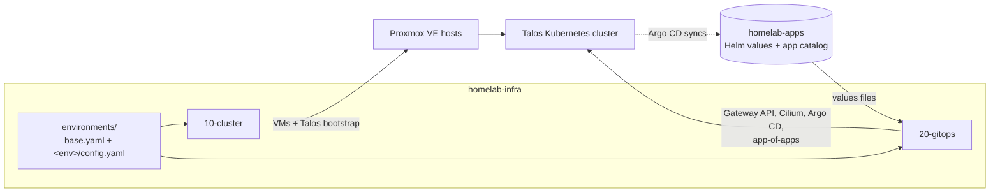

# homelab-infra

Infrastructure as code for a highly available [Talos Linux](https://www.talos.dev/) Kubernetes cluster on [Proxmox VE](https://www.proxmox.com/en/proxmox-virtual-environment), bootstrapped into a GitOps workflow driven by [Argo CD](https://argo-cd.readthedocs.io/).

This repository provisions the cluster and installs the minimum platform needed for Argo CD to take over. From that point on, everything running in the cluster is managed declaratively from the companion [`homelab-apps`](https://github.com/jkososki/homelab-apps) repository.

## Overview

Provisioning happens in two layers, each its own [OpenTofu](https://opentofu.org/) root module with separate state:

| Layer | Root module   | Responsibility |
| ----- | ------------- | -------------- |
| `10`  | `10-cluster/` | Creates Talos VMs across the Proxmox hosts, bootstraps the Kubernetes control plane behind a virtual IP, and outputs `kubeconfig` and `talosconfig`. |
| `20`  | `20-gitops/`  | Installs the bootstrap Helm releases (Gateway API CRDs, Cilium, Cilium resources, Argo CD) and the app-of-apps chart that hands control to Argo CD. |



### Bootstrap sequence

`20-gitops` installs these releases in order, waiting for each to become ready:

1. **Gateway API**: CRDs required by Cilium's Gateway implementation.
2. **Cilium**: CNI and kube-proxy replacement, pointed at the cluster VIP.
3. **Cilium resources**: cluster-level Cilium objects such as the shared Gateway and its load-balancer IP.
4. **Argo CD**: the GitOps controller.
5. **homelab** (`apps-manager` chart): the app-of-apps root that registers every other application with Argo CD.

Each release uses `lifecycle { ignore_changes = all }`. OpenTofu installs them once, then Argo CD owns their ongoing state, so later changes to these components belong in `homelab-apps`, not here.

## Repository layout

```text
.
├── 10-cluster/            # Layer 10: Proxmox VMs + Talos/Kubernetes bootstrap
├── 20-gitops/             # Layer 20: bootstrap Helm releases + Argo CD hand-off
├── modules/
│   └── inputs/            # Typed schema and validation for the merged config
├── environments/
│   ├── base.yaml          # Shared defaults for every environment
│   └── dev/
│       ├── config.yaml    # Environment overrides, deep-merged over base.yaml
│       ├── 10-cluster.backend
│       └── 20-gitops.backend
├── taskfile.yml           # Task runner entry points (init/plan/apply/destroy)
├── .pre-commit-config.yaml
└── .terraform-docs.yml
```

## Configuration model

Each root module reads two YAML files:

- `environments/base.yaml` holds defaults shared by all environments: cluster topology, node sizing, chart versions, and the location of the apps repository.
- `environments/<env>/config.yaml` holds environment-specific overrides.

The two are deep-merged with the [`isometry/deepmerge`](https://registry.terraform.io/providers/isometry/deepmerge/latest) provider, so an override file only needs to contain the keys it changes. The merged result is then validated against the typed schema in [`modules/inputs`](modules/inputs/variables.tf), which catches missing or mistyped fields before any resources are planned.

Helm values are not stored in this repository. Each entry under `apps_init` points to a base and an override values file in the `homelab-apps` repository, and both are fetched at plan time. Base configuration uses an `<env>` placeholder for the override path, and each environment replaces it with a concrete file.

### Default topology

The configuration in `base.yaml` describes a three-host Proxmox cluster:

| Role          | Count | vCPU    | Memory | Disks                 |
| ------------- | ----- | ------- | ------ | --------------------- |
| Control plane | 3     | 2       | 4 GiB  | 20 GB                 |
| Worker        | 3     | 8 to 14 | 48 GiB | 20 GB + 500 GB data   |

Nodes are spread one per Proxmox host per role, and the control plane is reachable through a shared virtual IP.

## Prerequisites

### Tooling

| Tool | Purpose |
| ---- | ------- |
| [OpenTofu](https://opentofu.org/) `>= 1.13.1` | Infrastructure provisioning |
| [Task](https://taskfile.dev/) | Task runner for all workflows |
| [talosctl](https://www.talos.dev/latest/talos-guides/install/talosctl/) | Talos node management |
| [kubectl](https://kubernetes.io/docs/tasks/tools/) | Cluster access |
| [prek](https://prek.j178.dev/) | Pre-commit hooks (contributors only) |
| [TFLint](https://github.com/terraform-linters/tflint), [Trivy](https://trivy.dev/), [terraform-docs](https://terraform-docs.io/) | Used by pre-commit hooks |

### Infrastructure and access

- A Proxmox VE cluster whose host names match `cluster.pve_hosts`, with a datastore for the Talos ISO (`cluster.iso_datastore`).
- A free block of addresses on the node network for the cluster VIP, the node IPs, and the ingress load-balancer IP.
- A Proxmox API token with permission to manage VMs and upload ISOs.
- A GitHub token that can read the `homelab-apps` repository.
- SSH access to GitHub. The cluster module, [`terraform-proxmox-talos-k8s`](https://github.com/jkososki/terraform-proxmox-talos-k8s), is fetched over SSH.

### Credentials

Providers read credentials from environment variables. Task automatically loads a `.env` file from the repository root, which is git-ignored:

```dotenv
# Proxmox (bpg/proxmox provider)
PROXMOX_VE_ENDPOINT=https://pve01.example.internal:8006/
PROXMOX_VE_API_TOKEN=user@pam!tofu=00000000-0000-0000-0000-000000000000

# SSH username & password for pve.
PROXMOX_VE_SSH_USERNAME=<username>
PROXMOX_VE_SSH_PASSWORD=<password>

# Path to kubeconfig
KUBE_CONFIG_PATH=~/.kube/config
```

See the [bpg/proxmox provider documentation](https://registry.terraform.io/providers/bpg/proxmox/latest/docs#environment-variables-summary) for other supported authentication methods, including the SSH settings some operations require.

## Usage

All workflows go through Task, using the pattern `<action>-<env>-<layer>`:

```sh
task --list
```

| Task                     | Description |
| ------------------------ | ----------- |
| `init-<env>-<layer>`     | Initialize the layer against the environment's backend |
| `plan-<env>-<layer>`     | Run `tofu plan` with the merged configuration |
| `apply-<env>-<layer>`    | Run `tofu apply` with the merged configuration |
| `destroy-<env>-<layer>`  | Run `tofu destroy` with the merged configuration |
| `export-configs`         | Write `talosconfig` and `kubeconfig` from layer 10's outputs |

Additional OpenTofu flags can be passed after `--`, for example `task plan-dev-10 -- -target=module.cluster`.

### Bringing up an environment

```sh
# 1. Provision the cluster
task init-dev-10
task plan-dev-10
task apply-dev-10

# 2. Export client configuration
task export-configs

# 3. Bootstrap the GitOps platform
task init-dev-20
task plan-dev-20
task apply-dev-20
```

> [!WARNING]
> `export-configs` overwrites `~/.talos/config` and `~/.kube/config`. Back up any existing configuration first. Layer 20 always reads `~/.kube/config` to connect to the cluster.

When layer 20 finishes, Argo CD reconciles the remaining workloads from `homelab-apps`.

### Tearing down

Destroy the layers in reverse order:

```sh
task destroy-dev-20
task destroy-dev-10
```

If Proxmox reports lock or concurrency errors during teardown, run with reduced parallelism: `task destroy-dev-10 -- -parallelism=1`.

## Adding an environment

1. Add the environment name to `VALID_ENVS` in [`taskfile.yml`](taskfile.yml).
2. Create `environments/<env>/config.yaml` with the overrides for that environment. At minimum, set each `apps_init.*.values.override` path.
3. Create `environments/<env>/10-cluster.backend` and `environments/<env>/20-gitops.backend` with that environment's backend settings.
4. Add the matching `env/<env>.values.yaml` files to `homelab-apps`.

## State

Both layers use the `local` backend, and each environment's backend files point at `environments/<env>/state/`. State files are git-ignored and contain sensitive data, including cluster credentials and secrets. Keep them out of version control and back them up somewhere secure.

To use a remote backend, change the `backend` block in each layer's `versions.tf` and update the per-environment `.backend` files.

## Development

This repository uses [prek](https://prek.j178.dev/) to run its pre-commit hooks:

```sh
prek install
prek run --all-files
```

The hooks cover formatting (`tofu fmt`), linting (TFLint), documentation generation (terraform-docs), security scanning (Trivy), secret detection ([Betterleaks](https://github.com/betterleaks/betterleaks)), and general file hygiene.

## Related repositories

- [`homelab-apps`](https://github.com/jkososki/homelab-apps): the Argo CD app-of-apps catalog and Helm values consumed by layer 20.
- [`terraform-proxmox-talos-k8s`](https://github.com/jkososki/terraform-proxmox-talos-k8s): the OpenTofu module that provisions Talos nodes on Proxmox.

## License

Released under the [MIT License](LICENSE).
